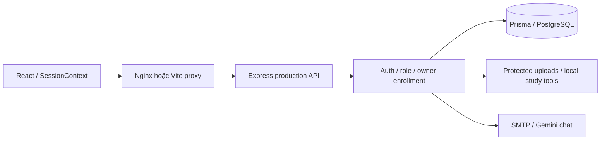

# Lumina LMS — AI Smart Learning Assistant

[](https://github.com/NgocTien2005/AI-Smart-Learning-Assistant/actions/workflows/ci.yml)

Nền tảng quản lý học tập bằng tiếng Việt cho **giảng viên, sinh viên và quản trị
viên**. Lumina kết nối khóa học, tài liệu, bài tập, chấm điểm và tiến độ trong
một ứng dụng fullstack; đồng thời cung cấp công cụ học từ nguồn tài liệu có quyền
truy cập. Dự án hướng tới một portfolio dễ chạy thử, đọc hiểu và kiểm chứng.

> Các luồng LMS đã có kiểm thử local và CI. Chat Gemini đã có bằng chứng hai lượt
> trả lời model thật với trích dẫn nguồn; hạn mức Free vẫn phụ thuộc provider.
> Dự án chưa được chứng nhận production-ready.

## Tính năng

| Vai trò | Luồng chính |
| --- | --- |
| **INSTRUCTOR** | Quản lý khóa học/bài học sở hữu, tài liệu, mã tham gia, danh sách học viên, bài tập, bài nộp và chấm điểm |
| **STUDENT** | Tham gia khóa học, đọc/tải tài liệu, theo dõi tiến độ, nộp bài, xem nhận xét và tiếp tục bài ôn trắc nghiệm |
| **ADMIN** | Tìm kiếm, cập nhật vai trò/thông tin, khóa/mở tài khoản; không tự bypass quyền nội dung khóa học |

- Đăng ký/đăng nhập bằng email + mật khẩu, khôi phục phiên qua `/api/auth/me`,
  đổi mật khẩu và quên/đặt lại mật khẩu qua SMTP khi được cấu hình.
- Đã gỡ đăng nhập/liên kết Google theo yêu cầu; không cần OAuth Client ID.
- PDF/TXT/Markdown/CSV có kiểm tra upload và tải qua API được bảo vệ. PDF chỉ
  trích xuất **lớp văn bản**, không có OCR.
- Quiz lưu snapshot câu hỏi, draft và version; server kiểm quyền/chấm điểm.
  Điều hướng trong app xử lý lưu/bỏ draft; browser unload không bảo đảm lưu mạng.
- UI có loading/error/empty states, bảo vệ response đến trễ và hỗ trợ bố cục hẹp,
  đồng thời giữ giao diện desktop theo vai trò.

## AI: có gì và giới hạn gì?

| Công cụ | Cách hoạt động | Giới hạn |
| --- | --- | --- |
| Tra cứu tài liệu | Tìm đoạn nguồn bằng token cục bộ | Không phải chatbot LLM hiểu mọi tài liệu |
| Tóm tắt trích xuất | Chọn câu từ nguồn | Không diễn giải bằng AI sinh nội dung |
| Quiz ôn tập | Generator nhận dạng mẫu câu định nghĩa | Có thể tạo ít câu hoặc thiếu nguồn phù hợp |
| Chat Gemini | Câu hỏi tự do theo nguồn được chọn, gọi `gemini-3.1-flash-lite` thật qua backend, trích dẫn được đối chiếu nguồn | Cần key/Free riêng, quyền chia sẻ nguồn; không OCR/web search, không bảo đảm mọi suy luận đều đúng |

Không tự gửi tài liệu riêng, lịch sử chat hoặc nội dung người dùng ra provider.
Gemini cần project Free **không bật billing**, key nhập riêng, xác nhận phạm vi
dữ liệu và giới hạn app. App không thể tự bảo đảm billing của project Google.
Xem [cấu hình Chat Gemini](docs/gemini-chat.md), [API demo hữu hạn](docs/demo-cloud-ai.md) và [bộ đánh giá AI](docs/ai-evaluation.md).

## Công nghệ và kiến trúc

| Lớp | Công nghệ |
| --- | --- |
| Frontend | React19, React Router7, Vite8 |
| Backend | Node.js24+, Express5, Prisma7, PostgreSQL17 |
| Tài liệu/email | PDF.js, Multer, Nodemailer/Gmail SMTP |
| Tests | Node test runner, Vitest, jsdom, React Testing Library |
| Vận hành | Docker Compose, Nginx, GitHub Actions |



Runtime backend là `backend/server.js` → `backend/src/app.js`.
`backend/app.js` là legacy không được server/current auth tests import.
JWT Bearer được lưu theo lựa chọn nhớ đăng nhập; middleware kiểm user hiện tại,
active và `authVersion`. Reset thành công thu hồi phiên cũ. Cookie HttpOnly chưa
được thay vào kiến trúc hiện tại; tradeoff XSS/CSRF được ghi trong
[thiết kế bảo mật](docs/security.md).

[Kiến trúc, ERD và luồng authentication](docs/architecture.md) ·
[Ranh giới module](docs/module-boundaries.md)

## Tự deploy lên web

Muốn demo bằng gói miễn phí: xem [Render + Supabase private Storage + Brevo HTTPS](docs/deploy-free.md). Cần cấu hình tài khoản/key riêng, xác minh sender và nghiệm thu provider; local tests không thay bằng chứng deploy thật.

Làm theo [hướng dẫn VPS Ubuntu + Docker + HTTPS](docs/deploy-vps.md): chuyển đúng
release, cấu hình domain/secrets riêng, dùng `compose.web.yaml` để chỉ mở HTTP ở
loopback rồi đặt Caddy HTTPS phía trước. Không dùng Vite hoặc dev override để public.
Xem [trạng thái release và việc còn mở](docs/release-status-20261117.md) trước khi
triển khai; config đã validate không đồng nghĩa VPS, TLS hoặc toàn bộ app đã nghiệm thu.

## Chạy bằng Docker

Yêu cầu: Docker Desktop chạy Linux containers; Git. Node24+ cần cho các lệnh
development/test trên host. Hai thư mục frontend/backend là hai package độc lập.

```powershell
git clone https://github.com/NgocTien2005/AI-Smart-Learning-Assistant.git
cd AI-Smart-Learning-Assistant
Copy-Item .env.docker.example .env
```

Sửa `.env` **cục bộ** để đặt `POSTGRES_PASSWORD` và `JWT_SECRET` mạnh. Không commit
file này hoặc gửi secret vào chat. Sau đó:

```powershell
docker compose up -d --build
docker compose ps
Invoke-RestMethod http://localhost:8080/api/health
```

Mở **http://localhost:8080**. PostgreSQL/backend chỉ ở network nội bộ; Nginx proxy
`/api`. Backend tự chạy `prisma migrate deploy` lúc khởi động. Health endpoint là
liveness; không thay cho kiểm chứng đọc/ghi database.

Để dừng: `docker compose down`. **Không dùng `down -v`** nếu cần giữ dữ liệu.
Không reset database hoặc sửa migration đã dùng.

### Frontend development tại localhost:5173

Chạy Docker với dev override để cho phép origin5173:

```powershell
docker compose -f compose.yaml -f compose.dev.yaml up -d --build
cd frontend
npm ci
npm run dev
```

Vite mặc định proxy `/api` đến `http://127.0.0.1:8080`. Nếu chạy backend riêng trên
host, đặt `$env:DEV_API_PROXY_TARGET='http://localhost:3000'` trước khi chạy Vite.
API client dùng cùng origin hoặc `VITE_API_URL` khi có override chủ động.

**Lưu ý runtime đã cấu hình riêng:** recreate backend bằng Compose thường có thể
làm mất key Gemini chỉ được nhập vào container qua launcher. Dùng hướng dẫn
provider riêng khi cần; không đọc/in Docker environment để lấy lại key.

### Nếu đăng nhập ở5173 bị lỗi

- **403 “Origin không được phép truy cập”**: backend đang chạy cấu hình Docker
  thường chỉ cho8080. Hãy dùng cả `compose.yaml` và `compose.dev.yaml` theo lệnh
  development phía trên; chỉ khởi động Vite không cập nhật CORS của backend.
  Không tắt CORS hoặc sửa mật khẩu để xử lý lỗi này.
- **401 thông tin đăng nhập không đúng**: API đã nhận request; kiểm tra đúng email,
  mật khẩu và trạng thái tài khoản. Seed rerun không khôi phục mật khẩu cũ.
- **Trang cũ vẫn hiện Google**: tải lại app. OAuth đã được gỡ; endpoint cũ trả404.
  Dùng email + mật khẩu; xem [thông báo tương thích](docs/google-sign-in.md).

CI kiểm tra một stack riêng; kết quả đó không xác nhận cấu hình container đang
chạy trên máy. Khi chuyển sang dev override, giữ cấu hình secret riêng và kiểm
tra lại health, login và `/api/auth/me` qua đúng origin đang mở.

## Dữ liệu demo và tài khoản

Dataset tổng hợp có **18 user**, gồm1ADMIN,4INSTRUCTOR,12STUDENT hoạt động và
1STUDENT đã khóa; **8 khóa học,48 bài học,26 tài liệu và24 bài tập**, cùng enrollment,
tiến độ, bài nộp/chấm điểm và quiz ở nhiều trạng thái.

Seed chỉ chạy trên target development/demo đã xác minh. Có dry-run, ownership
ledger và cơ chế chạy lại không tạo trùng; không tự seed khi server khởi động.

```powershell
node backend/scripts/seed-demo.mjs --project ai-smart-learning-assistant --api http://localhost:8080/api --dry-run
powershell -NoProfile -File scripts/start-demo-seed.ps1
```

Dev override phải được bật trước. Launcher cấp thông tin đăng nhập qua console
riêng khi **tạo mới**; không có mật khẩu dùng chung hard-code trong source và seed
rerun không reset tài khoản. Email demo dùng `.invalid`, không dùng để nhận thư.
ADMIN không được tạo từ public registration. Xem [hướng dẫn dataset](docs/demo-data.md)
và [demo Instructor → Student → Admin](docs/demo-script.md).

## Cấu hình tích hợp tùy chọn

- **Quên mật khẩu qua Gmail:** cấu hình `SMTP_USER`, `SMTP_APP_PASSWORD` và
  `APP_ORIGIN` trong môi trường riêng. Dùng App Password, không dùng mật khẩu
  Gmail thường. Email/reset URL không được ghi vào evidence. HTTP200/SMTP accepted
  không chứng minh thư đã tới hộp thư.
- OAuth Google đã ngừng hỗ trợ; không cấu hình Client ID/Client Secret.
- **Gemini:** [Chat Gemini và launcher cấu hình riêng](docs/gemini-chat.md).
  Key chỉ ở backend; không đặt vào biến `VITE_*`, source, ảnh hoặc chat.

## Kiểm thử và CI

Frontend, từ `frontend/`:

```powershell
npm ci
npm test
npm run lint
npm run build
```

Backend, từ `backend/`:

```powershell
npm ci
npm test
npm test -- --test-name-pattern=quiz
npx prisma validate
```

HTTP/database integration, từ **repository root**:

```powershell
node scripts/ci/integration.mjs
node scripts/ci/seed-integration.mjs
```

Các runner tạo project/network/volumes/port/secrets thử riêng, kiểm cả HTTP và
database backend thực sự kết nối, rồi dọn đúng containers/network của lượt thử.
Volumes được giữ lại; không trỏ test tới stack đang dùng hoặc local8081. Không
chỉ đổi `TEST_API_URL` rồi chạy harness trên database không xác định.

[GitHub Actions](.github/workflows/ci.yml) chạy **frontend, backend và HTTP/database**
khi push, pull request hoặc chạy tay, dùng Node24, lockfiles và quyền tối thiểu.
Integration còn kiểm seed create-only và phục hồi DB/tệp tổng hợp. CI cơ bản
không cần SMTP, Google credentials hoặc Gemini key. Xem [hướng dẫn/evidence CI](docs/continuous-integration.md).

## Cấu trúc repository

```text
frontend/src/
  app/          Router, session và application shell
  pages/        Auth, dashboard, course, account, admin
  components/   LMS panels, UI và route guards
  hooks/        Lifecycle/state được dùng lại
  services/     API client và helper thuần
backend/
  server.js     Production entrypoint
  src/routes/   Auth, admin, courses, lessons, assignments, quiz
  src/services/ Email, tài liệu và chat Gemini
  src/middleware/ Authentication, authorization, validation, rate limiting
  prisma/       Schema và migration history
  scripts/      Seed và integration harness
scripts/ci/     Package checks, isolated integration/recovery
specs/          Spec Kit specs, plans, tasks và verification
docs/           Kiến trúc, demo, quyết định kỹ thuật và vận hành
```

## Quyết định kỹ thuật và giới hạn còn lại

- Authorization được kiểm trên server theo role **và từng tài nguyên**; không
  chỉ ẩn nút ở frontend. Password reset/quiz concurrency có kiểm thử riêng.
- Rate limit và quota cloud hiện theo process; multi-replica
  và topology proxy cần thiết kế thêm. Không bật `trust proxy` tùy tiện.
- OAuth Google đã được ngừng hỗ trợ theo022. Chat Gemini có bằng chứng thật ở021;
  nghiệm thu demo hữu hạn cũ012/T012 vẫn tách riêng.
  Email recovery008/T023 đã có nghiệm thu lịch sử; cleanup008/T026 vẫn bị policy
  chặn và không được xóa bằng cách khác.
- Chưa có OCR, recommendations, notifications hoặc analytics toàn hệ thống.
- Public deployment còn cần domain/TLS, secrets/quyền DB, backup nhất quán,
  monitoring, kiểm tra tải/advisories và release/rollback trên môi trường thật.
  Synthetic recovery drill không chứng nhận RPO/RTO production.

## Tài liệu cho người review

[Tổng quan portfolio](docs/portfolio-overview.md) ·
[Hướng dẫn phỏng vấn](docs/interview-guide.md) ·
[Báo cáo cải thiện và bằng chứng](docs/portfolio-improvement-report.md) ·
[Quy trình Spec Kit](docs/development-workflow.md) ·
[Vận hành/backup/rollback](docs/operations.md) ·
[Production readiness](docs/production-readiness.md)

Không có deployed URL, benchmark hoặc kết quả provider thật được dựng lên để
minh họa. Trạng thái một hosted run phải đối chiếu đúng commit; badge CI không
thay cho nghiệm thu toàn bộ ứng dụng.
