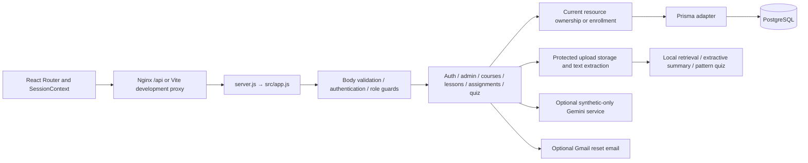
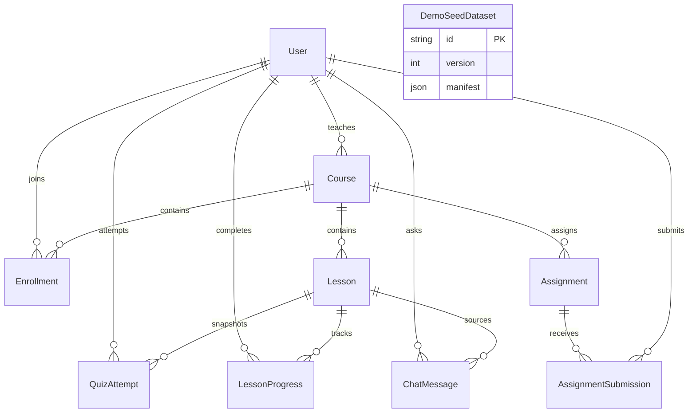
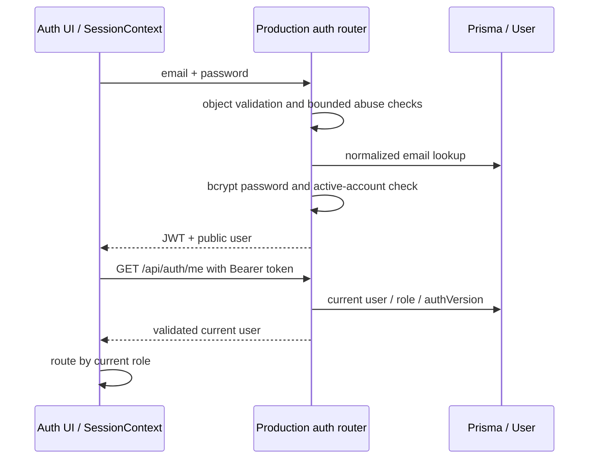

# Architecture and data model

This describes the combined portfolio reference branch. Separate feature PRs
and exact verification revisions are listed in the
[integration record](integration-review.md) and [report](portfolio-improvement-report.md).

## Runtime and module boundaries

[`backend/server.js`](../backend/server.js) starts the app assembled by
[`backend/src/app.js`](../backend/src/app.js). The root `backend/app.js` remains
a legacy auth harness and is not mounted by the server. Auth tests on the
combined branch exercise the production router factory/current-user middleware.

The courses router composes lesson and assignment child routers without changing
public paths. Reusable course access predicates, upload/document helpers and
progress mapping live in focused modules. HTTP boundary validation and role
checks remain separate from object ownership/enrollment. Quiz mutations retain
their own version/concurrency rules. See [module boundaries](module-boundaries.md).

React pages compose panels, with session state in
[`SessionContext`](../frontend/src/app/SessionContext.jsx) and HTTP handling in
[`api.js`](../frontend/src/services/api.js). Roster lifecycle and assignment form
helpers were extracted while preserving existing abort/stale-result behavior.
Course section/lesson selection is URL-backed. Quiz autosave is debounced and
versioned; explicit leave flushes or asks to stay/discard, while unload warns
without promising a successful network save.

## Entity relationships

The source of truth is [`schema.prisma`](../backend/prisma/schema.prisma).
`User.password` contains a hash and is never a public-user field.

Enrollment and submission each have a unique user/resource pair; lesson progress
uses a composite key. Quiz attempts persist question snapshots, draft/submitted
answers, version and final score; later source edits do not rewrite old snapshots.
The independent demo ledger identifies created synthetic rows/files, without
credentials. Document extraction metadata and sourceRevision distinguish an
uploaded successful text source from manual lesson content.

## Authentication and authorization

JWT is currently stored in localStorage or sessionStorage according to remember
choice. It is not an HttpOnly cookie session. XSS can expose browser tokens;
switching to cookies would require a documented migration and CSRF/origin design.
See [security tradeoffs](security.md). Current-user middleware checks activity
and authVersion so stale tokens do not preserve old account privileges.

Password reset stores only a token hash with expiry; successful single-use reset
changes the password and revokes old sessions. The generic forgot response does
not disclose account existence. Link navigation alone is not a validity check:
the reset POST enforces invalid/expired/used-token rejection. Password mutations
are not automatically replayed after uncertain network outcomes.

Google uses a challenge/cookie/nonce and verified identity token. Linking is an
explicit authenticated action; sign-in only resolves an already-linked active
account. An email match does not create or merge users. Real provider evidence
is still required separately; see [Google configuration](google-sign-in.md).

| Role | Global capability | Resource rule |
| --- | --- | --- |
| ADMIN | Account administration | No course-content bypass |
| INSTRUCTOR | Course/lesson/assignment authoring and grading | Must own the course |
| STUDENT | Join/leave, progress, submissions, quiz/study | Must have current enrollment |

Documents are downloaded through authenticated routes, not a public uploads
directory. Access is rechecked for quiz attempt actions and after delayed cloud
responses. Public registration allows only INSTRUCTOR/STUDENT.

## Study sources and privacy

Successful document text takes priority over manual content; replace/remove
invalidates stored text/hash and changes revision. PDF extraction is bounded
text-layer processing, not OCR. Local retrieval, extractive summary and pattern
quiz do not call a provider. Optional Gemini only accepts original owned demo
sources plus finite actions, with current access checks, timeout/size/quota
limits, no silent fallback, retry, tools or private-document transfer.
Deterministic contract evaluation and real provider quality are separate gates.

## Operation and scale limits

Compose has internal PostgreSQL/backend and a published Nginx frontend. Two npm
packages have separate lockfiles; no root npm workspace exists. Migration deploy
runs on backend startup; immutable history is preserved. Health is liveness;
integration separately verifies actual backend DB identity and writes.

Rate/challenge/quota stores are per-process, and Express does not blindly trust
forwarded IPs. Shared-proxy users may share IP throttles; multi-replica operation
needs a planned shared-state/topology change. DB least privilege, non-root upload
ownership migration, TLS, monitoring and real backup objectives remain open.
See [operations](operations.md) for logging/recovery and release constraints.
